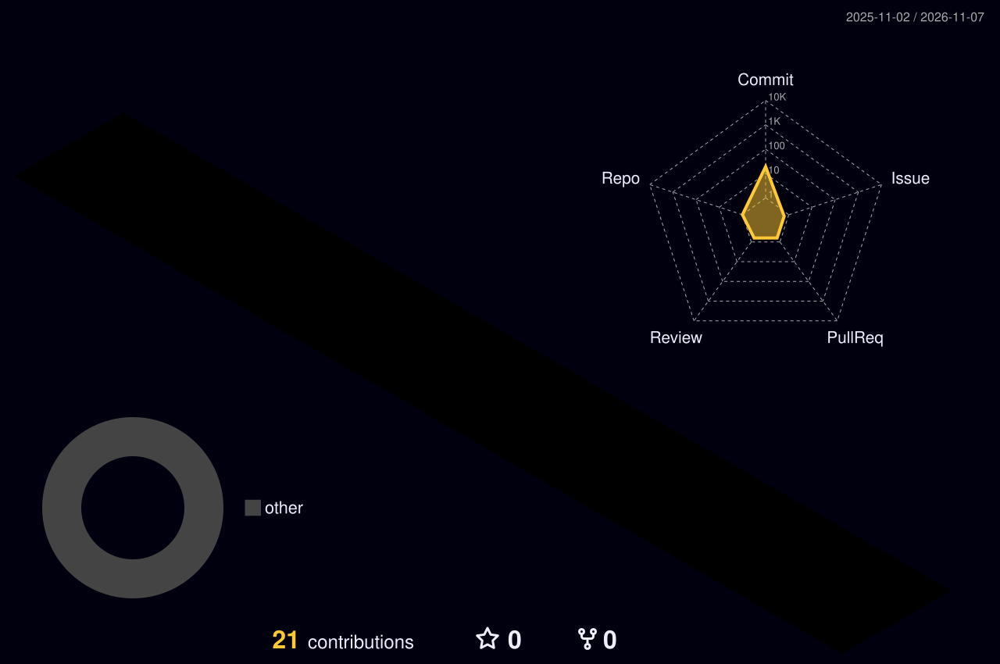

 

 

  
  
  

  

  

  

  

  

---

## 👨‍💻 About Me

  

> I am a Data Analytics learner from Dhaka. I love to find patterns, trends and stories hidden inside messy data.

🌱 *Currently Learning* → Python, SQL & Power BI 
📊 *Expert in* → Data Cleaning, Analysis & Visualization 
💡 *I find* → Business Insights from Raw Data 
🎯 *Goal* → Professional Data Analyst 
💬 *Ask me about* → Excel, SQL, Python, Power BI

## 🛠️ Tech Stack - Data Analytics

  
  
  
  
  

  
  
  
  
  

## 📊 GitHub Stats - My Growth

  
  

  
  

## 👀 Profile Visitors

  
  

## 🚀 My Projects

  

> 💡 Coming Soon: Sales Data Analysis with Excel + Power BI Dashboard - Stay Tuned!

## 🐍 My Contribution Snake

  

## 🎯 My Future Goal - 2026 Roadmap

| Month | What I Will Learn |
| :---: | :---: |
| ✅ Now | Excel, SQL Basics |
| 🔥 Next | Python + Pandas |
| 🚀 After | Power BI Dashboard |
| 🏆 Final Goal | Job as Data Analyst |

## 😂 Auto Changing Jokes - Programming, Data & Computer

  

  

  <i>Wait 3 Seconds - Joke Will Change Automatically 😂</i>

## 💡 My Coding Philosophy

  

  <b>"I Don't Just Analyze Data, I Tell Stories With Data."</b> 
    - MD. ARIF HOSSAIN

## 💡 My Coding Philosophy

  

  <b>"I Don't Just Analyze Data, I Tell Stories With Data."</b> 
    - MD. ARIF HOSSAIN

## 🧊 3D Contribution - My Work in 3D

  

## 📜 My Certificates & Achievements

| Certificate | Status | Year |
| :---: | :---: | :---: |
| 📊 *Excel for Data Analysis* | ✅ Completed | 2025 |
| 🗄️ *SQL Basics* | 🔥 Learning Now | 2026 |
| 🐍 *Python for Data* | 🎯 Next Target | 2026 |
| 📈 *Power BI Dashboard* | 🎯 Next Target | 2026 |

## 🌍 Visitors From Around The World

  

  <b>Thanks For Visiting My Profile! ❤️</b> 
  <i>From Dhaka, Bangladesh To The Whole World 🌍</i>

## 🤝 Let's Connect With Me

  
  
  
  

  

